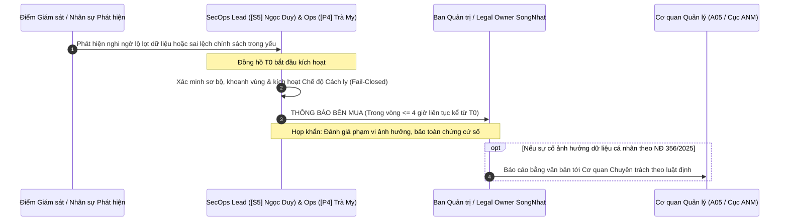
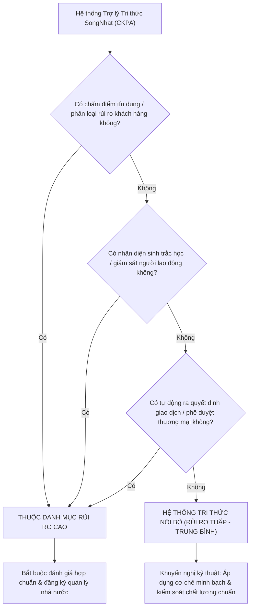
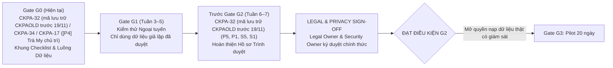

# HỒ SƠ RÀ SOÁT PHÁP LÝ TRIỂN KHAI & KIỂM KÊ LUỒNG DỮ LIỆU NHÀ CUNG CẤP
## SongNhat CRM Knowledge and Policy Assistant (CKPA)

> **Mã công việc:** `CKPA-32 (mã lưu trữ CKPAOLD trước 19/11)` — *CRM-G0-ST08: [G0][DEL06] Hoàn tất Điều khoản Vận hành & Pháp lý* kèm `CKPA-34` (CRM-G0-SUB23) & `CKPA-17` (CRM-G0-SUB10) (Thuộc Epic `CKPA-3`: *CRM-G0-EP01*)  
> **Cổng phát hành:** `Gate G0 - Ready to Build Discovery` *(Khung cơ sở chuyển tiếp tới `Gate G2` — Task CKPA-32 (mã lưu trữ CKPAOLD trước 19/11))*  
> **Tham chiếu đặc tả & hợp đồng:**  
> - RFP: `SEC 03`, `SEC 04`, `SEC 07`, `VN 05`, `Phụ lục F` (`R02–R05`, `R10`, `R11`), `Phụ lục C`  
> - SRS: `SRS-NFR-09`, `SRS-NFR-10`, `SRS-NFR-11`, `Mục 3.1`, `Mục 6.2`, `Mục 8.3`  
> **Chủ trì rà soát Pháp lý & Quyền riêng tư ([P5] Privacy & Security Owner):** **Nguyễn Anh Khoa**
> **Kê khai Hạ tầng & Nhà cung cấp phụ ([S5] Operations Specialist):** **Nguyễn Ngọc Duy**
> **Chủ đầu tư phê duyệt ([P1] Purchaser Sponsor):** **Văn Mỹ Vân**  
> **Phối hợp & Xác nhận kỹ thuật:** [S1] **Hoàng Tiến** (Named Lead / Scrum Master), [P4] **Ngô Thị Trà My** (Staff Users Lead)  
> **Đơn vị thẩm định & Ký duyệt thẩm quyền:** **Legal Owner** & **Privacy/Security Owner** (SongNhat)  
> **Ngày lập:** `17/11/2026` *(Bản cập nhật sau PM Review của [S1] Hoàng Tiến & đồng bộ cấu hình repo với [S5] Nguyễn Ngọc Duy)*  
> **Trạng thái:** `Khung cơ sở G0 hoàn thành — Chờ thẩm định & ký duyệt tại Gate G2 (CKPA-32 (mã lưu trữ CKPAOLD trước 19/11))`

---

## NGUYÊN TẮC BẤT BIẾN VỀ RANH GIỚI THẨM QUYỀN (NON-NEGOTIABLE PRINCIPLE)

> [!CAUTION]
> **ĐỘI NGŨ DỰ ÁN KHÔNG TỰ KẾT LUẬN PHÂN LOẠI AI HAY TUYÊN BỐ MIỄN TRỪ PHÁP LÝ THAY CHO LEGAL OWNER CỦA BÊN MUA.**
> 
> Căn cứ theo tuyên bố ràng buộc tại Trang 8, 25, 26 của RFP:
> 1. **Hosting tại Việt Nam, mã hóa và việc có nhân viên rà soát (staff verification) KHÔNG tự động xác lập sự tuân thủ hay miễn trừ pháp lý.**
> 2. **Quy chế nội bộ của SongNhat không thay thế pháp luật.** Bất kỳ tương tác pháp lý nào chưa rõ ràng hoặc có mâu thuẫn bắt buộc phải chuyển tới **Legal Owner** được ủy quyền của SongNhat.
> 3. Tài liệu này đóng vai trò là **Hồ sơ Kiểm kê Kỹ thuật & Khung Checklist Đối chiếu (Baseline & Evaluation Checklist)** do Chủ sở hữu Quyền riêng tư (`P5`) và Kỹ sư Vận hành (`S5`) thiết lập tại Cổng G0, nhằm cung cấp đầy đủ luận cứ kỹ thuật, luồng dữ liệu và ranh giới hệ thống để **Legal Owner và Privacy/Security Owner của SongNhat chính thức thẩm định và ký phê duyệt trước khi hệ thống tiếp cận dữ liệu thật tại Cổng G2 (Task CKPA-32 (mã lưu trữ CKPAOLD trước 19/11))**.

---

## MỤC LỤC
1. [Phần 1: Kiểm kê Luồng Dữ liệu & Quản trị Nhà cung cấp (SEC 04 & SRS-NFR-09)](#phần-1-kiểm-kê-luồng-dữ-liệu--quản-trị-nhà-cung-cấp-sec-04--srs-nfr-09)
   - 1.1 [Sơ đồ Luồng Dữ liệu Đầu cuối (End-to-End Data Flow)](#11-sơ-đồ-luồng-dữ-liệu-đầu-cuối-end-to-end-data-flow)
   - 1.2 [Kiểm kê Chi tiết 5 Cấu phần Dữ liệu (Prompts, Embeddings, Indexes, Logs, Backups)](#12-kiểm-kê-chi-tiết-5-cấu-phần-dữ-liệu-prompts-embeddings-indexes-logs-backups)
   - 1.3 [Danh mục Nhà cung cấp Dịch vụ & Bên Xử lý Phụ (Subprocessors)](#13-danh-mục-nhà-cung-cấp-dịch-vụ--bên-xử-lý-phụ-subprocessors)
   - 1.4 [Cam kết Cấm Huấn luyện & Tái sử dụng Trái phép (Zero Data Retention)](#14-cam-kết-cấm-huấn-luyện--tái-sử-dụng-trái-phép-zero-data-retention)
   - 1.5 [Cơ chế Tối thiểu hóa Đo lường Từ xa (Telemetry Minimization)](#15-cơ-chế-tối-thiểu-hóa-đo-lường-từ-xa-telemetry-minimization)
   - 1.6 [Quy trình Thông báo Sự cố Dữ liệu & Kiểm soát Trọng yếu trong 4 Giờ (SEC 07)](#16-quy-trình-thông-báo-sự-cố-dữ-liệu--kiểm-soát-trọng-yếu-trong-4-giờ-sec-07)
2. [Phần 2: Khung Checklist Rà soát Pháp lý Triển khai theo Phụ lục F RFP](#phần-2-khung-checklist-rà-soát-pháp-lý-triển-khai-theo-phụ-lục-f-rfp)
   - 2.1 [Luật Bảo vệ Dữ liệu Cá nhân số 91/2025/QH15 & NĐ 356/2025/NĐ-CP (R02, R03)](#21-luật-bảo-vệ-dữ-liệu-cá-nhân-số-912025qh15--nđ-3562025nđ-cp-r02-r03)
   - 2.2 [Luật Trí tuệ Nhân tạo số 134/2025/QH15 & NĐ 142/2026/NĐ-CP (R04, R10)](#22-luật-trí-tuệ-nhân-tạo-số-1342025qh15--nđ-1422026nđ-cp-r04-r10)
   - 2.3 [Luật An ninh mạng số 116/2025/QH15 (R05)](#23-luật-an-ninh-mạng-số-1162025qh15-r05)
   - 2.4 [Danh mục Hệ thống AI Rủi ro cao — Quyết định 33/2026/QĐ-TTg (R11)](#24-danh-mục-hệ-thống-ai-rủi-ro-cao--quyết-định-332026qđ-ttg-r11)
3. [Phần 3: Đề xuất Lịch Lưu giữ Vận hành & Phân biệt Chặn Truy cập (Phụ lục C)](#phần-3-đề-xuất-lịch-lưu-giữ-vận-hành--phân-biệt-chặn-truy-cập-phụ-lục-c)
4. [Phần 4: Lộ trình & Thủ tục Trình duyệt Chính thức tại Cổng G2 (CKPA-32 (mã lưu trữ CKPAOLD trước 19/11))](#phần-4-lộ-trình--thủ-tục-trình-duyệt-chính-thức-tại-cổng-g2-ckpa-32)

---

# PHẦN 1: KIỂM KÊ LUỒNG DỮ LIỆU & QUẢN TRỊ NHÀ CUNG CẤP (SEC 04 & SRS-NFR-09)

## 1.1 Sơ đồ Luồng Dữ liệu Đầu cuối (End-to-End Data Flow)

Hệ thống CKPA được thiết kế với kiến trúc **dữ liệu khép kín tối đa** nhằm đảm bảo an toàn bí mật thương mại và dữ liệu cá nhân theo tiêu chuẩn `SEC 01–06`:

```mermaid
flowchart TD
    subgraph USER_ZONE["1. VÙNG NGƯỜI DÙNG NỘI BỘ (SONGNHAT)"]
        U["Authorized Staff (20 Named Users)"]
        FE["Split-Screen Workspace UI (React/Next.js)"]
        U <-->|"HTTPS / TLS 1.3 (mTLS nội bộ - mục tiêu G1-G2)"| FE
    end

    subgraph ONPREM_ZONE["2. HẠ TẦNG MÁY CHỦ NỘI BỘ / LOCAL VM (VIỆT NAM)"]
        NGINX["Reverse Proxy / Nginx Guard"]
        AUTH["RBAC & Session Manager (shared/auth.py)"]
        MINIMIZE["Input Minimization & PII Guard (pii_guard.py - mục tiêu G1-G2)"]
        CORE["Core Logic: Ingestion, Policy Selection & Validation"]
        PG[("PostgreSQL + pgvector<br>(Bảng documents, passages, passage_embeddings)")]
        REDIS[("Redis Cache<br>(TTL ngắn, Purge 5 phút)")]
        AUDIT[("Audit Logs Store<br>(Khử PII, lưu vết 12 tháng)")]
        
        FE <--> NGINX
        NGINX --> AUTH --> MINIMIZE --> CORE
        CORE <--> PG
        CORE <--> REDIS
        CORE --> AUDIT
    end

    subgraph EXTERNAL_ZONE["3. NHÀ CUNG CẤP MÔ HÌNH NỀN TẢNG (SUBPROCESSOR API)"]
        EMBED_GW["Embedding API Gateway<br>(text-embedding-3-small, 1536 dim)"]
        LLM_GW["LLM Inference API Gateway<br>(OpenAI / Azure OpenAI / Vertex AI)"]
        AI_CORE["Foundation Models<br>(Zero Data Retention / No Training)"]
        
        CORE -->|"Passages văn bản chính sách đã duyệt (tạo vector)"| EMBED_GW
        EMBED_GW --> AI_CORE
        AI_CORE -->|"Vector embeddings 1536 chiều"| CORE
        
        MINIMIZE -->|"Prompt đã lọc PII & trích dẫn ngữ cảnh (Chỉ gửi text được phép)"| LLM_GW
        LLM_GW --> AI_CORE
        AI_CORE -->|"Nội dung thô diễn đạt tiếng Việt"| CORE
    end

    CORE -->|"Render tất định trường quan trọng + Trích dẫn gốc"| FE
```

> [!NOTE]
> **Ghi chú hiện trạng Môi trường Dev so với Kiến trúc Mục tiêu G1–G2:**  
> Trong môi trường thử nghiệm cơ sở ban đầu (`docker-compose.yml`), hệ thống chỉ khởi chạy 2 container cơ sở hạ tầng dữ liệu: `db` (`pgvector/pgvector:pg16`) và `redis` (`redis:7-alpine`).  
> Các thành phần an toàn mở rộng gồm: bộ lọc PII tự động chặn prompt (`pii_guard.py`), chứng thực mTLS nội bộ, và hệ thống giám sát tập trung Prometheus/Grafana là **kiến trúc mục tiêu sẽ được tích hợp đầy đủ trong các Sprint Cổng G1 và Cổng G2 (theo profile `app`, CKPA-7, CKPA-8 và CKPA-23)**.

---

## 1.2 Kiểm kê Chi tiết 5 Cấu phần Dữ liệu (Prompts, Embeddings, Indexes, Logs, Backups)

Căn cứ yêu cầu kiểm toán tại `SEC 04` và `SRS-NFR-09`, bảng kiểm kê chi tiết về địa điểm xử lý, lưu trữ, thẩm quyền và giới hạn được xác lập như sau:

| Cấu phần Dữ liệu | Mục đích Xử lý | Địa điểm Xử lý & Lưu trữ | Vị trí Địa lý | Thời hạn Lưu giữ & Cơ chế Hủy | Kiểm soát Truy cập & Thẩm quyền (UserRole) |
|---|---|---|---|---|---|
| **1. Prompts & Inferences** *(Câu hỏi nhân viên + Ngữ cảnh trích dẫn)* | Sinh câu trả lời giải thích bằng tiếng Việt tự nhiên | - Xử lý trong RAM máy chủ nội bộ. - Gửi qua HTTPS tới LLM Inference API. - **Không lưu trên đĩa bên thứ ba**. | - Máy chủ nội bộ: Việt Nam. - LLM Inference API: Khu vực Đông Á / Đông Nam Á (theo hợp đồng Enterprise). | **Tức thời (In-memory only)**. Không lưu trữ vĩnh viễn trên máy chủ AI; xóa khỏi RAM ngay khi phản hồi hoàn tất. | Phân quyền RBAC theo `UserRole` (`reader`, `policy_owner`, `steward`, `referral_handler`, `administrator`, `privacy_security_owner`, `independent_evaluator`). |
| **2. Embedding API Calls** *(Vector hóa chính sách & câu hỏi)* | Tạo vector nhúng 1536 chiều phục vụ tìm kiếm ngữ nghĩa (`EMBEDDING_MODEL=text-embedding-3-small`) | - Đoạn văn bản chính sách đã duyệt được gửi qua HTTPS tới Embedding API. - **Không lưu trên đĩa bên thứ ba**. | - Embedding API Gateway: Khu vực Đông Á / Đông Nam Á (theo hợp đồng Enterprise). | **Tức thời (In-memory only)**. Chỉ tính toán vector trả về và giải phóng RAM, không lưu trữ văn bản trên máy chủ của bên thứ ba. | Chỉ tiến trình nội bộ `worker/index_task.py` và backend retrieval thực thi; không mở endpoint ra Internet. |
| **3. Knowledge Indexes** *(Vector embeddings & Chỉ mục toàn văn)* | Tìm kiếm ngữ nghĩa và trích xuất đoạn văn bản chính sách phù hợp | - Lưu trữ trong bảng **`passage_embeddings`** của PostgreSQL/pgvector. - Bộ nhớ đệm tra cứu trên Redis. | - Máy chủ nội bộ: Việt Nam (100% trong nước). | Theo vòng đời chính sách (`KNW 03`). Khi chính sách bị rút (`withdrawn`), chỉ mục bị xóa/vô hiệu hóa tức thời; cache Redis dọn sạch trong 5 phút. | Chỉ dịch vụ nội bộ Backend và Knowledge Steward (`P3`) được quyền cập nhật; cấm kết nối công cộng từ Internet. |
| **4. Audit Logs & Telemetry** *(Nhật ký tác vụ, chi phí & kiểm toán)* | Kiểm toán tuân thủ, đo lường nỗ lực Pilot, giám sát chi phí token | - Cơ sở dữ liệu nội bộ PostgreSQL (`audit_logs`). - Log tập trung hệ thống nội bộ (Local syslog). | - Máy chủ nội bộ: Việt Nam (100% trong nước). | Đề xuất tối đa **12 tháng** phục vụ mục đích kiểm toán (`Phụ lục C`); tự động xoay vòng (log rotation) và xóa vật lý sau khi hết hạn. | Chỉ Administrator (`[S5] Ngọc Duy`), Privacy/Security Owner và Quản trị viên Kiểm toán có quyền đọc; cấm sửa/xóa log thủ công (Append-only). |
| **5. Backups** *(Bản sao lưu cơ sở dữ liệu & cấu hình)* | Khôi phục thảm họa (Disaster Recovery), bảo đảm RTO 4h / RPO 24h (`OPS 07`) | - Ổ đĩa sao lưu mã hóa cục bộ (`AES-256`). - Sao lưu lạnh (Cold storage) tách biệt mạng vật lý. | - Kho lưu trữ nội bộ: Việt Nam (100% trong nước). | Đề xuất chu kỳ xoay vòng **35 ngày** (`Phụ lục C`). Bản sao lưu cũ hơn 35 ngày tự động bị hủy vật lý an toàn. | Khóa mã hóa quản lý độc lập ngoài source code; chỉ SecOps Lead (`[S5] Ngọc Duy`) và người được ủy quyền khôi phục. |

---

## 1.3 Danh mục Nhà cung cấp Dịch vụ & Bên Xử lý Phụ (Subprocessors)

Hệ thống CKPA triệt để tối giản các bên phụ thuộc bên thứ ba. Toàn bộ hạ tầng lưu trữ, cơ sở dữ liệu và quản lý phiên đều chạy trên máy chủ nội bộ do SongNhat kiểm soát. 

Căn cứ cấu hình hệ thống thực tế tại `.env.example` và `backend/src/config.py`:
* **Cấu hình mô hình ngôn ngữ:** `LLM_PROVIDER=openai` (hỗ trợ adapter `azure` / `local`), `LLM_MODEL=gpt-4o`.
* **Cấu hình mô hình vector:** `EMBEDDING_MODEL=text-embedding-3-small`, `EMBEDDING_DIM=1536`.
* **Hạn mức cước gọi:** `LLM_MAX_INPUT_TOKENS=6000`, `LLM_MAX_OUTPUT_TOKENS=900`, `LLM_MAX_CALLS_PER_MONTH=2000`.

Danh mục Bên xử lý phụ (Subprocessors) được xác lập:

1. **Nhà cung cấp Mô hình Chính (Primary Subprocessor):**
   * **Tên pháp nhân:** OpenAI, LLC *(hoặc Microsoft Corporation thông qua dịch vụ Microsoft Azure OpenAI Service)*.
   * **Dịch vụ sử dụng:** 
     - LLM Inference API: `gpt-4o` (sinh câu trả lời tiếng Việt trích dẫn).
     - Embedding API: `text-embedding-3-small` (tính toán vector nhúng 1536 chiều).
   * **Vai trò pháp lý:** Bên xử lý dữ liệu phụ (Subprocessor) theo thỏa thuận xử lý dữ liệu doanh nghiệp (Enterprise DPA).
   * **Vị trí trung tâm dữ liệu xử lý:** Khu vực Đông Á / Đông Nam Á (ví dụ: Azure OpenAI khu vực `Japan East` hoặc `East Asia / Singapore`).
   * **Chính sách bảo mật:** Áp dụng điều khoản OpenAI / Azure Business Terms: **Zero Data Retention và cam kết không sử dụng dữ liệu khách hàng để huấn luyện mô hình**.

2. **Phương án Thay thế Tương thích (Alternative Subprocessor Option):**
   * **Tên pháp nhân:** Google Cloud / Alphabet Inc.
   * **Dịch vụ:** Google Cloud Vertex AI (Model: Gemini API Enterprise / Claude on Vertex).
   * **Vị trí trung tâm dữ liệu xử lý:** Khu vực Đông Nam Á — Singapore (`asia-southeast1`).
   * **Tính sẵn sàng kiến trúc:** Module backend sử dụng thiết kế trừu tượng hóa (Provider Adapter Pattern); hệ thống có thể chuyển đổi provider cấu hình qua biến môi trường `LLM_PROVIDER` mà không cần sửa đổi mã nguồn nếu Legal Owner yêu cầu chỉ định vị trí địa lý tại Singapore.

---

## 1.4 Cam kết Cấm Huấn luyện & Tái sử dụng Trái phép (Zero Data Retention)

Căn cứ yêu cầu bắt buộc tại `SEC 04` (*"Prohibit unauthorized training and reuse, minimize telemetry and disclose retention and deletion limits"*):

1. **Điều khoản Cấm Huấn luyện (No Model Training):**
   - Hợp đồng dịch vụ API sử dụng tài khoản Doanh nghiệp (Enterprise Tier API), trong đó nhà cung cấp cam kết bằng văn bản:
     > *"Không sử dụng dữ liệu khách hàng (bao gồm văn bản câu hỏi, ngữ cảnh chính sách đính kèm, văn bản tạo embedding và câu trả lời sinh ra) để huấn luyện lại, tinh chỉnh (fine-tune) hoặc cải thiện bất kỳ mô hình ngôn ngữ nền tảng nào của nhà cung cấp hoặc bên thứ ba."*
2. **Chính sách Không Lưu giữ Dữ liệu (Zero Data Retention - ZDR):**
   - Toàn bộ nội dung prompt, completion và embedding payload chỉ tồn tại trong bộ nhớ khả biến (ephemeral memory) trong thời gian thực thi tính toán suy luận và bị giải phóng ngay sau khi gói phản hồi được gửi về cho Backend của SongNhat.
   - Yêu cầu cấu hình tính năng tắt lưu log nội dung (Disable prompt logging on provider side / Azure Data Opt-Out) trên bảng điều khiển của nhà cung cấp.

---

## 1.5 Cơ chế Tối thiểu hóa Đo lường Từ xa (Telemetry Minimization)

Để ngăn chặn việc rò rỉ siêu dữ liệu hành vi hoặc thông tin nội bộ ra các mạng giám sát toàn cầu:
* **Tắt bỏ toàn bộ Analytics bên thứ ba:** Không tích hợp bất kỳ SDK phân tích người dùng, công cụ heatmap, hay tracker nào của bên thứ ba (như Google Analytics, Mixpanel, Sentry Cloud, Datadog Public) vào hệ thống Frontend Workspace hoặc Backend.
* **Giám sát cục bộ (Local Monitoring — Mục tiêu G1–G2):** Mọi chỉ số hiệu năng (Latency p95, số lượng token in/out, lỗi 5xx, tỷ lệ kích hoạt Hold) được thu thập cục bộ thông qua Prometheus/Grafana chạy trong mạng nội bộ SongNhat, tách biệt với mạng công cộng.
* **Telemetry của nhà cung cấp AI API:** Chỉ duy trì các chỉ số tính cước kỹ thuật thuần túy (số token tiêu thụ, mã trạng thái HTTP 200/429/500). Tuyệt đối không gửi tiêu đề câu hỏi, mã nhân viên hay nội dung văn bản kèm theo gói tin đo lường.

---

## 1.6 Quy trình Thông báo Sự cố Dữ liệu & Kiểm soát Trọng yếu trong 4 Giờ (SEC 07)

Căn cứ `SEC 07` và `SRS-NFR-09`, dự án cam kết mục tiêu thời gian phản ứng khi phát sinh sự cố:

* **Mục tiêu hợp đồng bắt buộc:** Nhà cung cấp và đội ngũ vận hành kỹ thuật phải thông báo chính thức cho Ban Quản trị Bên mua (SongNhat) trong vòng **tối đa 4 giờ liên tục** (`within four elapsed hours`) kể từ thời điểm nhận biết về một sự cố nghi ngờ liên quan đến dữ liệu sản xuất hoặc sai lệch kiểm soát chính sách trọng yếu.
* **Bảo toàn chứng cứ:** Toàn bộ log truy cập, trạng thái container, dấu vết mạng tại thời điểm xảy ra sự cố phải được đóng băng nguyên trạng (read-only snapshot) để phục vụ công tác thanh tra của Legal/Security Owner và cơ quan chức năng nếu có yêu cầu.

---

# PHẦN 2: KHUNG CHECKLIST RÀ SOÁT PHÁP LÝ TRIỂN KHAI THEO PHỤ LỤC F RFP

Khung checklist dưới đây được cấu trúc theo 6 văn bản pháp quy cốt lõi tại Phụ lục F, phân tách rõ giữa **Thực trạng Thiết kế Kỹ thuật (10 Thành viên RFP (P1–P5, S1–S5) xác nhận)** và **Nội dung Cần Thẩm định & Ký duyệt (Legal & Privacy Owner SongNhat thực hiện tại Gate G2)**.

---

## 2.1 Luật Bảo vệ Dữ liệu Cá nhân số 91/2025/QH15 & NĐ 356/2025/NĐ-CP (R02, R03)

* **Hiệu lực:** 01/01/2026.
* **Tài liệu tham chiếu:** Luật số 91/2025/QH15 và Nghị định số 356/2025/NĐ-CP hướng dẫn thi hành.

| Hạng mục Kiểm tra | Thực trạng & Thiết kế Kỹ thuật Hệ thống CKPA (G0) | Nội dung Trình Thẩm định & Ký duyệt (Legal Owner G2) | Trạng thái Thẩm định |
|---|---|---|:---:|
| **1. Xác định Vai trò Pháp lý** | - SongNhat: Bên Kiểm soát Dữ liệu Cá nhân (*Data Controller*). - Đơn vị triển khai phần mềm: Bên Xử lý Dữ liệu Cá nhân (*Data Processor*). - Nhà cung cấp LLM/Embedding: Bên Xử lý Phụ (*Subprocessor*). | Phê duyệt bản phân định vai trò và trách nhiệm pháp lý trong hợp đồng dịch vụ công nghệ. | `[ ] Chờ Legal Owner duyệt` |
| **2. Nguyên tắc Giảm thiểu Dữ liệu (Minimization)** | - **Base Scope tuyệt đối không nạp hồ sơ khách hàng** (`SEC 02`). - Module `pii_guard.py` (triển khai G1–G2) tự động phát hiện và che giấu/chặn số CCCD, số điện thoại, email cá nhân trước khi gửi prompt. - Đào tạo nhân viên không gõ tên khách hàng vào câu hỏi. | Xác nhận cơ chế lọc PII và cam kết Base Scope không thu thập dữ liệu cá nhân khách hàng đáp ứng điều kiện miễn trừ rủi ro cao. | `[ ] Chờ Legal Owner duyệt` |
| **3. Cơ sở Pháp lý Xử lý (Lawful Basis)** | - Hệ thống chỉ xử lý dữ liệu phục vụ điều hành nội bộ doanh nghiệp và hướng dẫn nhân viên theo hợp đồng lao động/nội quy lao động. | Xác nhận cơ sở pháp lý hợp pháp (sự đồng ý của người lao động hoặc lợi ích hợp pháp của doanh nghiệp) cho 20 nhân sự sử dụng. | `[ ] Chờ Legal Owner duyệt` |
| **4. Đánh giá Tác động Chuyển Dữ liệu ra Nước ngoài** | - Chỉ có text câu hỏi (đã qua lọc PII) và trích dẫn quy trình nội bộ gửi tới API Đông Á / Đông Nam Á. - Không chuyển danh bạ, hồ sơ khách hàng ra khỏi Việt Nam. | Xác nhận luồng dữ liệu kỹ thuật có cấu thành hành vi "chuyển dữ liệu cá nhân ra nước ngoài" theo NĐ 356 hay không; duyệt hồ sơ đánh giá tác động chuyển dữ liệu (nếu luật yêu cầu). | `[ ] Chờ Legal Owner duyệt` |

---

## 2.2 Luật Trí tuệ Nhân tạo số 134/2025/QH15 & NĐ 142/2026/NĐ-CP (R04, R10)

* **Hiệu lực:** Luật số 134/2025/QH15 hiệu lực từ 01/03/2026; Nghị định số 142/2026/NĐ-CP hiệu lực từ 01/05/2026.

| Hạng mục Kiểm tra | Thực trạng & Thiết kế Kỹ thuật Hệ thống CKPA (G0) | Nội dung Trình Thẩm định & Ký duyệt (Legal Owner G2) | Trạng thái Thẩm định |
|---|---|---|:---:|
| **1. Vai trò Nhà triển khai AI (AI Deployer)** | - SongNhat là đơn vị triển khai (*Deployer*). - Nhà cung cấp giải pháp/mô hình là *Provider*. - Hệ thống sử dụng nội bộ (Internal Enterprise Assistant). | Phê duyệt Ma trận Trách nhiệm Nhà cung cấp – Đơn vị Triển khai (RACI Matrix theo Luật AI). | `[ ] Chờ Legal Owner duyệt` |
| **2. Trách nhiệm Minh bạch (Transparency)** | - Giao diện hiển thị nhãn cảnh báo rõ ràng: *"Đây là câu trả lời do Trợ lý AI tổng hợp từ tài liệu nội bộ; nhân viên phải tự kiểm tra trích dẫn trước khi hành động"* (`KNW 01, 02`). - Phân biệt rõ văn bản trích dẫn nguyên văn với lời giải thích của AI. | Xác nhận thông điệp minh bạch trên giao diện người dùng đáp ứng đầy đủ yêu cầu công bố của Luật AI. | `[ ] Chờ Legal Owner duyệt` |
| **3. Bất biến Giám sát của Con người (Human-in-the-loop)** | - Trợ lý AI chỉ giải thích quy trình, **tuyệt đối không tự động duyệt ngoại lệ, không tự cấp chiết khấu, không ra quyết định giao dịch** (`ANS 07`). - Toàn bộ thẩm quyền hành động thuộc về con người theo phân cấp. | Xác nhận hệ thống không thay thế thẩm quyền pháp lý của con người; không vi phạm quy định về quyết định tự động gây bất lợi. | `[ ] Chờ Legal Owner duyệt` |
| **4. Hồ sơ Kỹ thuật & Báo cáo Sự cố AI** | - Lưu vết toàn bộ prompt, kết quả trích xuất và tham số suy luận phục vụ thanh tra kỹ thuật. - Quy trình ứng phó khi AI phát sinh ảo giác nghiêm trọng (`Incident Runbook`). | Thẩm định cấu trúc tài liệu kỹ thuật và quy trình thông báo sự cố AI bất thường tới cơ quan quản lý nhà nước nếu có yêu cầu. | `[ ] Chờ Legal Owner duyệt` |

---

## 2.3 Luật An ninh mạng số 116/2025/QH15 (R05)

* **Hiệu lực:** 01/07/2026.
* **Tài liệu tham chiếu:** Luật số 116/2025/QH15.

| Hạng mục Kiểm tra | Thực trạng & Thiết kế Kỹ thuật Hệ thống CKPA (G0) | Nội dung Trình Thẩm định & Ký duyệt (Legal Owner G2) | Trạng thái Thẩm định |
|---|---|---|:---:|
| **1. Phân loại Cấp độ An toàn Hệ thống Thông tin** | - Hệ thống phục vụ 20 người dùng nội bộ, xử lý thông tin nghiệp vụ thông thường (không chứa bí mật nhà nước, không thuộc hệ thống trọng yếu quốc gia). | Phê duyệt hồ sơ đề xuất cấp độ an toàn thông tin của hệ thống (đề xuất: Cấp độ 2 theo quy định pháp luật VN). | `[ ] Chờ Legal Owner duyệt` |
| **2. Tiêu chuẩn An toàn & Mã hóa** | - Mã hóa dữ liệu truyền dẫn bằng `TLS 1.3`. - Mã hóa lưu trữ bằng `AES-256`. - Quản lý bí mật (API Keys, DB Passwords) qua biến môi trường độc lập, cấm lưu trong mã nguồn (`SEC 06`). | Xác nhận giải pháp an ninh mạng đáp ứng tiêu chuẩn an toàn thông tin bắt buộc theo Luật An ninh mạng 2025. | `[ ] Chờ Legal Owner duyệt` |
| **3. Kiểm soát Lỗ hổng & Phần mềm Độc hại** | - Quét lỗ hổng dependency hàng tuần (`pip-audit`, `npm audit`). - Cô lập tệp CSV nhập liệu qua thư mục Quarantine độc lập (`WP 02`, `DAT 08`). | Xác nhận quy trình kiểm soát lỗ hổng và rà quét an ninh định kỳ trước khi triển khai chính thức. | `[ ] Chờ Legal Owner duyệt` |

---

## 2.4 Danh mục Hệ thống AI Rủi ro cao — Quyết định 33/2026/QĐ-TTg (R11)

* **Căn cứ:** Quyết định số 33/2026/QĐ-TTg của Thủ tướng Chính phủ (Báo cáo ngày 02/07/2026).

* **Phân tích cơ sở kỹ thuật:**
  1. Hệ thống CKPA chỉ phục vụ việc tra cứu, giải thích văn bản quy chế và định tuyến luồng xử lý nội bộ trong 3 nhóm chính sách phân phối sản phẩm công nghiệp (`[R01]`).
  2. Hệ thống hoàn toàn không áp dụng công nghệ nhận dạng sinh trắc học, không chấm điểm tín dụng, không tuyển dụng/đánh giá nhân sự tự động, và không tự động giao kết hợp đồng hay phê duyệt tài chính.
* **Đề xuất từ Đội ngũ Kỹ thuật:** Phân loại hệ thống vào nhóm **Hệ thống AI Tri thức Doanh nghiệp Thông thường (Không thuộc Danh mục AI Rủi ro cao)** theo Quyết định 33/2026/QĐ-TTg.
* **Ranh giới thẩm quyền:** **Legal Owner của SongNhat sẽ chính thức rà soát các tiêu chí áp dụng cụ thể và ký văn bản phân loại pháp lý tại Cổng G2 (CKPA-32 (mã lưu trữ CKPAOLD trước 19/11)).**

---

# PHẦN 3: ĐỀ XUẤT LỊCH LƯU GIỮ VẬN HÀNH & PHÂN BIỆT CHẶN TRUY CẬP (PHỤ LỤC C)

Căn cứ Phụ lục C của RFP và `SRS-NFR-11`, đội ngũ kỹ thuật đề xuất khung thời hạn lưu giữ vận hành. Các mốc thời gian này là **đề xuất kỹ thuật/vận hành, không phải thời hạn luật định bắt buộc**; Legal và Records Owner của SongNhat sẽ xem xét phê duyệt:

| Loại Bản ghi Dữ liệu | Nội dung Hợp đồng & Cấu trúc Bản ghi | Đề xuất Thời hạn Lưu giữ | Xử lý khi Hết hạn |
|---|---|---|---|
| **Đoạn tri thức (Knowledge Passages)** | ID, Tiêu đề, Trích dẫn gốc, Nội dung, Phiên bản, Người duyệt, Khoảng hiệu lực, Trạng thái (`documents`, `passages`). | Duy trì tri thức hiện hành đã duyệt và lịch sử cần thiết phục vụ đối soát. | Lưu trữ vĩnh viễn trong kho lưu trữ kiểm toán; gắn cờ `superseded` hoặc `withdrawn`. |
| **Trường quan trọng (Critical Fields)** | Rule ID, Version, Kiểu dữ liệu, Giá trị, Toán tử, Đơn vị, Vai trò duyệt, Ngoại lệ (`critical_fields`). | Đồng bộ theo vòng đời của đoạn tri thức liên kết. | Vô hiệu hóa ngay khi phiên bản chính sách hết hiệu lực. |
| **Hồ sơ Câu hỏi & Giới thiệu (Answer & Referral)** | Task ID, Câu hỏi, Ngữ cảnh được phép, Phiên bản nguồn, Câu trả lời, Holds, Feedback, Trạng thái chuyển tiếp. | Đề xuất tối đa **12 tháng** phục vụ giải quyết khiếu nại và đánh giá chất lượng. | Tự động làm sạch định kỳ hàng quý sau khi hết 12 tháng. |
| **Bản xuất thô (Raw Exports)** | Dữ liệu xuất tạm thời phục vụ đối soát và nạp dữ liệu. | Giới hạn quyền nghiêm ngặt; xóa sạch các bản sao tiện ích sau **90 ngày**. | Xóa vật lý an toàn khỏi hệ thống lưu trữ tạm. |
| **Bản sao lưu (Database Backups)** | Bản sao lưu toàn vẹn hệ thống phục vụ khắc phục thảm họa. | Xoay vòng tối đa **35 ngày**. | Ghi đè tự động theo chính sách backup rotation. |
| **Tùy chọn O1 (Nếu được kích hoạt sau G3)** | Khóa tài khoản, trường CRM tối thiểu, phiên bản. | Tối đa **12 tháng** khi được chứng minh; xóa sớm hơn khi hết nhu cầu. | Xóa sạch ngay khi hết thời hạn phê duyệt. |

### Phân biệt Chặn Truy cập Tức thời vs. Hết hạn Vật lý:
* **Chặn tức thời (Immediate Blocking):** Khi một chính sách bị rút (`Withdrawal`) hoặc người dùng bị thu hồi quyền, hệ thống **chặn hiển thị ngay lập tức trong thời gian thực (0 giây)** và xóa sạch dữ liệu khỏi bộ nhớ đệm (Redis Cache) trong vòng **tối đa 5 phút** (`OPS 05` / `SEC 05`).
* **Hết hạn vật lý (Physical Expiry):** Dữ liệu lịch sử vẫn được bảo lưu có kiểm soát trong bảng lưu trữ kiểm toán độc lập để phục vụ trách nhiệm giải trình pháp lý, chỉ bị tiêu hủy hoàn toàn sau khi hết thời hạn lưu giữ đã được Legal Owner phê duyệt.

---

# PHẦN 4: LỘ TRÌNH & THỦ TỤC TRÌNH DUYỆT CHÍNH THỨC TẠI CỔNG G2 (CKPA-32 (mã lưu trữ CKPAOLD trước 19/11))

Để đảm bảo dự án triển khai đúng tiến độ 12 tuần mà vẫn tuân thủ chặt chẽ pháp luật, quy trình phối hợp giữa Đội ngũ Triển khai và Ban Pháp chế SongNhat được thiết lập như sau:

### Kế hoạch hành động cụ thể cho Cổng G2 (Task CKPA-32 (mã lưu trữ CKPAOLD trước 19/11)):
1. **Tuần 6 (12/12 – 16/12/2026):** 
   - Chuyên viên Vận hành (`S5`) và Quyền riêng tư (`P5`) phối hợp Chuyên viên Vận hành (`S5`) cập nhật số liệu kiểm kê thực tế của hạ tầng Docker/Cloud đã dựng tại G1 vào hồ sơ này.
   - Bổ sung kết quả rà quét an ninh mạng và nhật ký xử lý dữ liệu giả lập.
2. **Tuần 7 (17/12 – 19/12/2026):**
   - Trình nộp toàn bộ Hồ sơ Đánh giá Pháp lý Triển khai cho **Legal Owner** và **Privacy/Security Owner** của SongNhat.
   - Tổ chức phiên rà soát chính thức, ghi nhận ý kiến thẩm định và ký phê duyệt văn bản trước ngày họp Hội đồng Cổng G2 (dự kiến 24/12/2026).
3. **Điều kiện mở Cổng G2:**
   - Không được phép mở quyền sử dụng cho 5 người dùng Pilot trên dữ liệu thực tế nếu chưa có **chữ ký phê duyệt bằng văn bản** của Legal Owner và Privacy/Security Owner trên hồ sơ này.

---

## XÁC NHẬN CỦA ĐỘI NGŨ LẬP KHUNG CƠ SỞ G0

| KỸ SƯ THƯƠNG MẠI & TESTOPS ([P4] Trà My) | KỸ SƯ BẢO MẬT & DEVOPS ([S5] Ngọc Duy) | QUẢN TRỊ DỰ ÁN ([S1] Hoàng Tiến) |
|:---:|:---:|:---:|
| *(Đã lập khung kiểm kê & checklist)* | *(Đã rà soát kỹ thuật, cấu hình repo & luồng API)* | *(Đã rà soát tiến độ & ranh giới G0)* |
| **Ngô Thị Trà My** | **Nguyễn Ngọc Duy** | **Hoàng Tiến** |
